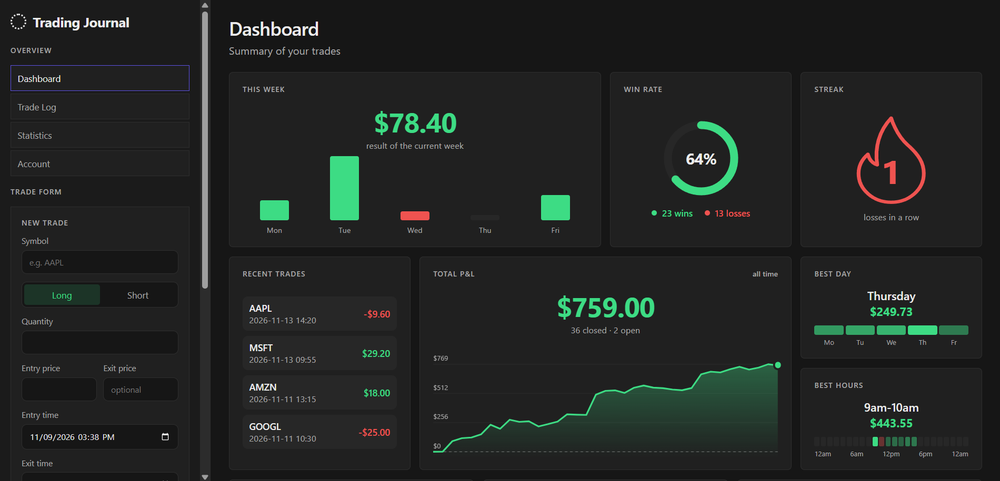
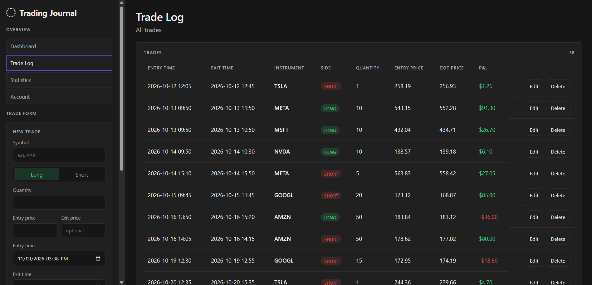

# Trading Journal

A full-stack web app for logging trades and analysing trading performance. Add long/short trades, track open and closed positions, and see P&L, win rate, streaks and best trading hours on a dashboard.

**Stack:** React 19 · Vite · Node.js · Express 5 · JSON file storage

## Screenshots





## Features

- **Trade log** – create, edit and delete trades (symbol, side, quantity, entry/exit price, entry/exit date and time); open positions are supported (no exit yet)
- **Stats dashboard** with panels for:
  - this week's P&L by day, total P&L over time, win rate ring
  - win/loss streak with a flame indicator
  - best day of the week and best trading hours
  - profit factor, average win, average loss
  - P&L by instrument and recent trades
- **Calendar** in the sidebar showing days with trades
- **To-do list** for trading notes and tasks
- **REST API** with server-side validation; trades are persisted to `trades.json`
- Charts (bars, ring, flame, line) are hand-written SVG components – no chart library

## Project structure

```
.
├── index.js            # Express API + JSON persistence
├── trades.json         # Sample trades (data store)
├── test.http           # Example API requests (VS Code REST Client)
└── client/             # React + Vite frontend
    └── src/
        ├── components/ # Panels, charts, calendar, trade form, table
        ├── pages/      # Dashboard, Trade Log
        ├── hooks/      # useTrades (API access)
        └── utils/      # computeStats – all statistics logic
```

## Getting started

Requires Node.js 18+.

```bash
# 1. Install dependencies
npm install
npm install --prefix client

# 2. Start the API (http://localhost:3001)
npm run dev

# 3. In a second terminal, start the frontend (http://localhost:5173)
npm run dev --prefix client
```

The Vite dev server proxies `/api` requests to the Express server.

## API

| Method | Endpoint          | Description        |
| ------ | ----------------- | ------------------ |
| GET    | `/api/trades`     | List all trades    |
| GET    | `/api/trades/:id` | Get one trade      |
| POST   | `/api/trades`     | Create a trade     |
| PUT    | `/api/trades/:id` | Replace a trade    |
| DELETE | `/api/trades/:id` | Delete a trade     |

Example trade:

```json
{
  "symbol": "META",
  "side": "long",
  "quantity": 10,
  "entryPrice": 543.15,
  "exitPrice": 552.28,
  "entryTime": "2026-10-13T09:50",
  "exitTime": "2026-10-13T11:50"
}
```

Validation rules: `symbol` non-empty string, `side` is `long` or `short`, `quantity` and prices are positive numbers, times use `YYYY-MM-DDTHH:MM`. `exitPrice` and `exitTime` are optional (open position). Invalid requests return `400` with a list of errors.

More example requests are in [test.http](test.http).

## Possible next steps

- Replace the JSON file with a database (SQLite/PostgreSQL)
- Authentication and per-user journals
- Automated tests for the API and `computeStats`
- Statistics and Account pages (currently placeholders)

## License

MIT
